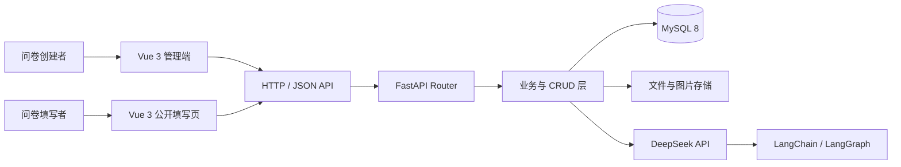
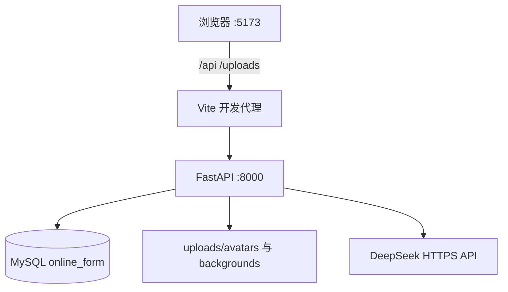
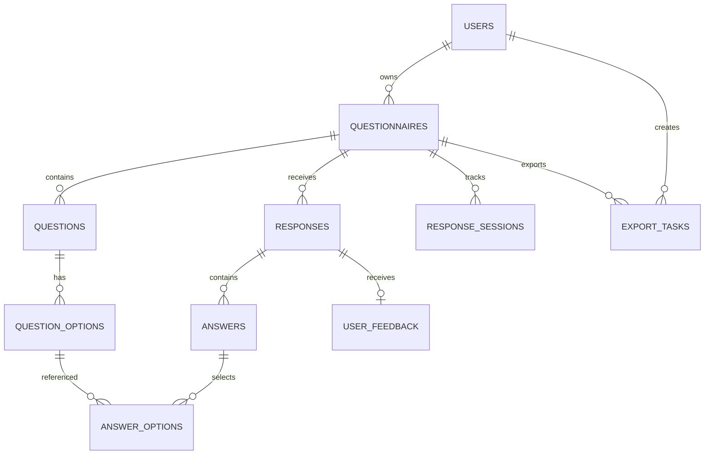

# 在线表格智能问卷系统概要设计说明书

> 文档编号：OF-HLD-002  
> 版本：V1.0（评审稿）  
> 日期：2026-09-18

## 1. 设计目标

系统采用前后端分离架构，将展示交互、业务接口、数据访问、智能服务和持久化存储分层。设计重点是：

1. 覆盖问卷设计、传播、填写、治理、分析、导出的完整链路。
2. 管理端资源按用户隔离，公开填写端保持低进入门槛。
3. AI 只使用经过授权的真实统计数据，并输出可追溯证据。
4. 核心问卷功能不依赖 AI，AI 服务异常时系统仍可正常运行。
5. 结构清晰、配置外置，便于比赛部署、演示和后续扩展。

## 2. 系统总体架构



### 2.1 前端层

- Vue 3 Composition API 组织状态和业务交互。
- TypeScript 约束问卷、题目、答卷和用户数据结构。
- Vite 提供开发服务器、接口代理和生产构建。
- 页面由登录、管理工作台、公开填写页两条主入口组成。
- Lucide Icons 统一顶部导航图标风格。

### 2.2 接口层

- FastAPI 负责路由、参数校验、依赖注入和 OpenAPI 文档。
- Pydantic Schema 对请求数据执行结构和范围校验。
- JWT 依赖统一解析当前用户并检查账号状态。
- 当前后端实际注册 44 条 API 路径。

### 2.3 业务与数据访问层

- Router 只负责 HTTP 语义和响应包装。
- CRUD 层处理问卷持久化、统计聚合、导出和异常评分。
- SQLAlchemy AsyncSession 执行异步数据库操作。
- 事务失败时统一回滚，资源访问必须带用户所有权条件。

### 2.4 智能服务层

- DeepSeek 提供大语言模型能力。
- LangChain 封装模型调用。
- LangGraph 维护分析追问的短期对话上下文。
- AI 返回结构化 JSON，并经过服务端解析和 Schema 校验。

## 3. 逻辑模块划分

| 模块 | 主要职责 | 对应前端/后端 |
|---|---|---|
| 账号中心 | 注册、登录、资料、头像、退出 | MainLayout、SettingsPage、user API |
| 模板中心 | 模板分类、搜索、预置问卷结构 | SurveyEditor |
| 问卷设计器 | 题目编辑、设置、背景、预览、AI 生成 | SurveyEditor、questionnaire API、ai API |
| 问卷管理 | 统计、搜索、状态、复制、删除 | QuestionnaireList |
| 发布传播 | 公开码、链接、二维码、来源参数 | questionnaire API、PublicSurvey |
| 填写与反馈 | 会话、校验、提交、结果、体验反馈 | PublicSurvey、public API |
| 数据分析 | 总览、趋势、来源、逐题统计、详情 | AnalysisPage、analysis/response API |
| 质量治理 | 异常扫描、风险解释、人工复核 | AnalysisPage、anomaly CRUD |
| AI 洞察 | 数据洞察、证据、追问、清空上下文 | AnalysisPage、ai/ai_chat CRUD |
| 数据导出 | 任务创建、格式生成、下载、删除 | ExportPage、export API |

## 4. 运行架构



生产部署时，前端 `dist` 可由 Nginx 或静态服务器提供，`/api` 和 `/uploads` 反向代理至 FastAPI。比赛本机演示可分别启动前后端。

## 5. 前端设计

### 5.1 页面结构

| 页面 | 功能 |
|---|---|
| 登录/注册 | 身份入口、错误反馈、账号切换 |
| 我的表格 | 指标概览、搜索筛选、问卷生命周期操作 |
| 创建/编辑 | 模板、题目编辑、AI、背景、设置抽屉、预览、发布 |
| 表格分析 | 问卷切换、指标、趋势、来源、逐题统计、答卷、异常、AI、反馈 |
| 导出数据 | 配置导出任务、查看记录、下载与删除 |
| 账号设置 | 资料、头像和账号概览 |
| 公开填写 | 实名/匿名填写、提交结果和体验反馈 |

### 5.2 状态管理

项目规模适合使用组件状态和 Props/Emit：

- `MainLayout` 持有当前页面、编辑问卷 ID 和选中分析问卷 ID。
- 登录令牌存入 `localStorage`，用户资料使用自定义事件同步。
- 公开填写会话令牌存入 `sessionStorage`，提交成功后清除。
- 分析页使用并行请求加载总览、题目和答卷，再加载趋势、来源、异常和反馈。

### 5.3 API 访问

公共 `apiFetch` 负责：

- 拼接后端基础地址。
- 写入 JSON 请求头和 Bearer Token。
- 解包 `code/message/data` 响应。
- 识别 401 并触发统一登录失效事件。
- 将后端错误转换为前端可显示消息。

## 6. 后端设计

### 6.1 分层结构

```text
backend/
├─ main.py          应用入口、中间件、路由注册、静态文件
├─ router/          HTTP 接口与权限依赖
├─ schemas/         请求和响应数据校验
├─ crud/            业务规则、查询、统计、AI 与导出
├─ models/          SQLAlchemy 数据模型
├─ config/          数据库与环境配置
├─ utils/           JWT 与密码安全工具
└─ uploads/         头像和问卷背景
```

### 6.2 统一响应

业务接口主要返回：

```json
{
  "code": 200,
  "message": "success",
  "data": {}
}
```

HTTP 异常使用合适状态码和 `detail` 描述。前端统一提取并显示错误。

### 6.3 接口分组

| 前缀 | 功能 |
|---|---|
| `/api/user` | 注册、登录、资料、密码、头像 |
| `/api/questionnaire` | 问卷 CRUD、背景、发布、二维码、状态 |
| `/api/public` | 公开问卷、会话、提交、反馈 |
| `/api/response` | 答卷列表、详情、异常和有效性 |
| `/api/analysis` | 总览、趋势、来源、逐题统计 |
| `/api/export` | 导出任务、状态、下载和删除 |
| `/api/ai` | 问卷生成、优化、维度、总结、洞察、对话 |
| `/api/feedback` | 创建者查看填写体验反馈 |

## 7. 数据架构



### 7.1 核心实体

| 实体 | 说明 |
|---|---|
| users | 账号、密码哈希、资料和状态 |
| questionnaires | 问卷信息、状态、公开码、填写规则和背景 |
| questions | 题型、标题、必填和排序 |
| question_options | 选择题选项和排序 |
| responses | 填写者、来源、时长、有效性、风险信息 |
| answers / answer_options | 文本答案和选择项关联 |
| response_sessions | 填写会话、活动、超时和完成状态 |
| export_tasks | 导出配置、状态、文件元数据 |
| user_feedback | 提交后的评分和问题反馈 |

## 8. 安全设计

1. 密码通过 bcrypt 哈希，不保存明文。
2. JWT 中只存用户身份标识，管理请求需携带 Bearer Token。
3. 数据查询组合 `resource_id + user_id`，阻止水平越权。
4. 公开码使用随机值，不暴露数据库顺序 ID。
5. 公开提交再次校验问卷状态、会话、必填题和合法选项。
6. 上传文件生成随机文件名，避免目录穿越和重名覆盖。
7. CORS 仅允许配置的前端来源。
8. `.env` 不进入比赛交付包。

## 9. 可靠性与降级

- AI 服务不可用时，只影响 AI 生成和洞察，不影响核心问卷流程。
- 趋势或来源专用接口失败时，前端可根据已加载答卷计算回退数据。
- 填写活动上报失败不会阻止用户继续填写。
- 预览模式不提交、不保存答卷。
- 数据库会话异常时自动回滚。

## 10. 当前边界与后续扩展

### 10.1 当前边界

- 导出任务元数据保存在数据库，但导出文件字节当前保存在后端进程内存；服务重启后旧任务文件需要重新生成。
- AI 对话记忆当前为进程内存，服务重启后上下文清空。
- 匿名限填按 IP 判断，共享网络可能产生误判。
- 当前为个人工作区，不含多人协作和角色审批。

### 10.2 可扩展方向

- 将导出文件迁移到本地持久目录或对象存储。
- 使用 Redis 保存 AI 对话和填写频控状态。
- 增加团队空间、成员角色和问卷协作。
- 增加矩阵题、排序题、逻辑跳转和题目分页。
- 引入自动化测试、性能测试和可观测性平台。

