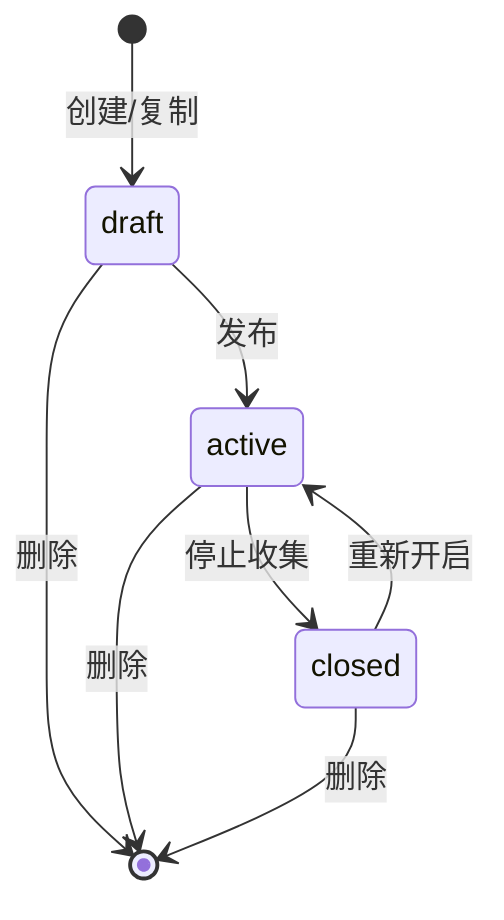
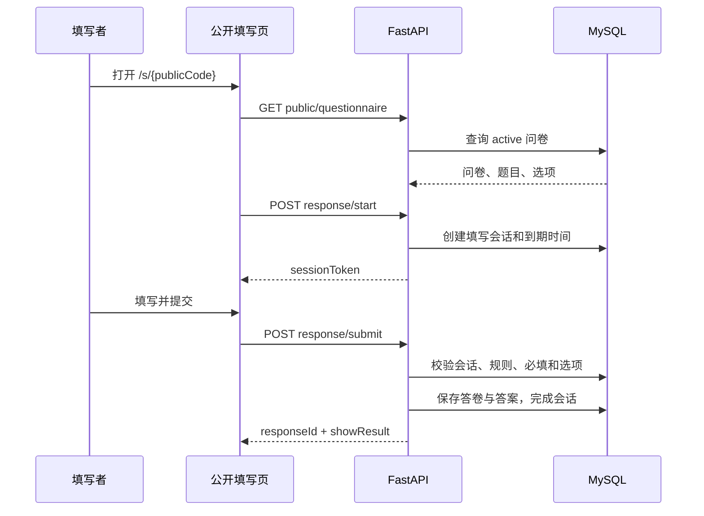

# 在线表格智能问卷系统详细设计说明书

> 文档编号：OF-LLD-003  
> 版本：V1.0（评审稿）  
> 日期：2026-09-18

## 1. 文档目的

本文档说明核心数据结构、关键流程、状态转换、算法、接口约束和异常处理，用于证明需求已经落实到可执行设计，并为测试和后续维护提供依据。

## 2. 核心数据结构

### 2.1 问卷结构

```ts
type QuestionType =
  | 'single' | 'multiple' | 'text' | 'date'
  | 'rating' | 'number' | 'phone'

interface Questionnaire {
  id?: number
  title: string
  description?: string | null
  status?: 'draft' | 'active' | 'closed'
  anonymous: boolean
  oneResponse?: boolean
  showResult?: boolean
  responseTimeoutMinutes: number
  questions: QuestionItem[]
}
```

问卷题目通过 `sortOrder` 保持顺序。单选和多选题保存选项，其他题型的选项数组为空。

### 2.2 答卷结构

- `responses` 保存答卷级元数据和风险状态。
- `answers` 保存每份答卷对每道题的文本内容。
- `answer_options` 保存答案与选项的多对多关系。
- `response_sessions` 记录一次填写过程，与完成后的答卷一对一关联。

## 3. 问卷生命周期设计



### 3.1 发布

1. 验证问卷属于当前用户。
2. 验证标题、题目和选择题选项。
3. 如尚无公开码，生成随机唯一公开码。
4. 生成公开 URL 和带 `source=qrCode` 的二维码 URL。
5. 状态更新为 `active`，记录发布时间。

### 3.2 停止收集

1. 验证所有权。
2. 状态更新为 `closed`，记录停止时间。
3. 公开问卷查询只匹配 `active`，因此链接立即不可填写。

## 4. 问卷保存设计

### 4.1 前端校验

- 标题不能为空。
- 填写时间必须是 1 至 1440 的整数。
- 至少一道题。
- 所有题目标题不能为空。
- 单选和多选题必须包含有效选项。

### 4.2 更新策略

问卷更新时以后端提交结构为准同步题目和选项。排序由数组索引转换为 `sortOrder`。问卷设置字段与题目结构在同一保存操作中提交，保证编辑器中的状态一致。

### 4.3 设置抽屉

- 打开时保存匿名、限填、时间和结果展示的快照。
- 取消、遮罩或 Esc 关闭时恢复未保存快照。
- “开启收集”调用独立发布/停止接口，属于即时操作，不随快照回滚。
- “保存设置”复用问卷保存逻辑，但不跳转回列表。

## 5. 公开填写流程



### 5.1 来源识别

1. URL 参数 `source=qrCode` 时记录为二维码。
2. 浏览器 User-Agent 表明微信环境时记录为微信转发。
3. 其他情况记录为公开链接。

来源值固定为 `publicLink`、`qrCode`、`wechat`，避免前后端统计口径不一致。

### 5.2 实名与匿名

- 匿名问卷允许姓名和邮箱为空。
- 实名问卷要求姓名非空、邮箱格式正确。
- 后端再次检查实名字段，不能只依赖前端。

### 5.3 每人限填一次

- 匿名问卷：查询同一问卷、相同提交 IP 的既有答卷。
- 实名问卷：查询同一问卷、忽略大小写后相同邮箱的既有答卷。
- 存在记录时返回 HTTP 409。

### 5.4 填写时间限制

- 创建填写会话时计算 `expires_at = now + response_timeout_minutes`。
- 提交时若当前时间达到或超过 `expires_at`，会话标记为 `expired` 并拒绝提交。
- 活动上报更新 `last_activity_at`，用于评估填写过程，不延长绝对到期时间。

## 6. 异常答卷检测算法

系统采用可解释的规则评分，不直接删除答卷。

| 规则 | 条件 | 分值 |
|---|---|---:|
| 填写速度异常 | 时长小于 `max(5秒, 题目数×2秒)` | 40 |
| 作答比例过低 | 有回答题目占比低于 30% | 25 |
| 连续选择同一位置 | 至少 5 个单选回答，80% 以上选择相同选项位置 | 25 |
| 文本高度重复 | 至少 3 个文本回答，80% 以上内容相同 | 20 |

总风险分上限为 100，达到 40 分进入异常列表。每条异常同时保存中文原因，创建者可将其确认无效或恢复有效。人工复核后使用 `confirmed` 或 `dismissed`，再次扫描不会覆盖人工判断。

伪代码：

```text
score = 0
if duration < threshold: score += 40
if answered_ratio < 0.3: score += 25
if same_option_position_ratio >= 0.8: score += 25
if repeated_text_ratio >= 0.8: score += 20
risk_score = min(score, 100)
```

## 7. 统计分析设计

### 7.1 总览指标

- 总答卷数：问卷下全部 `responses` 数量。
- 有效答卷数：`is_valid = true` 的数量。
- 平均填写时长：答卷 `duration_seconds` 的平均值。
- 完成率：由完成答卷和填写会话数据计算。

### 7.2 趋势

按提交日期聚合最近 7 天或 30 天数据，缺失日期补零。前端采用固定坐标系绘制折线，避免数据变化导致布局跳动。

### 7.3 来源

按三种固定来源分组计数：

```text
percentage = source_count / all_source_count × 100%
```

显示值保留一位小数。无答卷时为 0%。

### 7.4 逐题统计

- 单选/多选：按选项聚合数量和比例。
- 文本、日期、数字、电话：保留回答列表或用于 AI 总结。
- 仅统计当前用户拥有问卷的数据。

## 8. AI 设计

### 8.1 问卷生成

输入：用户需求、期望题目数、可选标题和已有题目。  
输出：包含标题、说明和题目数组的 JSON。

服务端处理：

1. 明确限定 7 种题型。
2. 要求选择题至少两个选项。
3. 从模型输出中提取 JSON 对象。
4. 丢弃未知题型、空标题和无效选择题。
5. 重建排序字段并限制题目数量。

### 8.2 有证据的洞察

输入包含当前问卷的总览、趋势和逐题统计。Prompt 明确要求数字只能来自输入。输出通过 Schema 校验：

```json
{
  "findings": [
    {
      "conclusion": "结论",
      "evidence": [
        {"sourceType": "question", "sourceId": "12", "text": "具体数据"}
      ]
    }
  ],
  "suggestions": ["建议"]
}
```

### 8.3 连续追问

`thread_id` 由用户 ID、问卷 ID 和前端会话 ID 组合，确保不同用户和问卷上下文隔离。LangGraph 的内存检查点保存当前进程内对话；用户可主动清空。

## 9. 数据导出设计

### 9.1 生成步骤

1. 验证问卷所有权。
2. 校验全部、近 7 天或自定义日期范围。
3. 加载答卷、答案和已选选项。
4. 以答卷为行、题目为列组织二维数据。
5. 按配置追加答卷元数据列。
6. 生成 UTF-8 BOM CSV、UTF-8 JSON 或 XLSX。
7. 保存任务元数据并在进程内缓存下载字节。

### 9.2 文件名安全

问卷标题中的 `\ / : * ? " < > |` 替换为下划线，限制标题长度，避免 Windows 文件名非法和路径注入。

### 9.3 已知限制

当前导出内容存于进程内存，数据库只保存任务元数据。后端重启后旧任务的下载内容不会保留，比赛演示前应保持服务稳定；终稿建议迁移至持久目录或对象存储。

## 10. 鉴权与资源隔离

### 10.1 登录

1. 根据邮箱查询用户。
2. 使用 bcrypt 校验密码。
3. 生成 JWT。
4. 前端保存令牌并在后续请求携带 `Authorization: Bearer <token>`。

### 10.2 管理接口

`get_current_user` 解码令牌并重新查询用户。CRUD 查询使用 `Questionnaire.user_id == current_user.id` 等条件，避免仅凭资源 ID 访问他人数据。

## 11. 错误处理

| 场景 | 处理 |
|---|---|
| 登录失效 | 返回 401，前端清除用户状态并回登录页 |
| 资源不存在或无权访问 | 返回 404，避免泄露资源存在性 |
| 请求数据不合法 | 返回 400/422 和具体字段提示 |
| 重复提交 | 返回 409 |
| AI 输出无法解析 | 返回 502，提示重新生成 |
| AI Key 缺失 | 返回 500 并提示配置 |
| 数据库异常 | 统一回滚事务 |

## 12. 关键需求追踪

| 需求 | 设计实现 |
|---|---|
| FR-SET-05 | response_sessions 到期时间与提交校验 |
| FR-FILL-03 | 前后端双重验证和选项归属检查 |
| FR-ANA-07 | 四类可解释规则风险评分 |
| FR-AI-02 | 真实聚合数据输入、证据输出、Schema 校验 |
| FR-EXP-01 | CSV/JSON 编码与 openpyxl XLSX 生成 |
| FR-AUTH-03 | JWT 依赖与前端统一 401 处理 |

